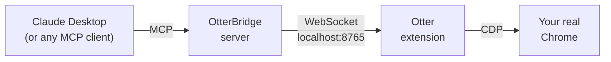

<div align="center">


# Otter & OtterBridge — Browser MCP

**Let your AI assistant drive your real Chrome — and ask you first before anything risky.**

[](https://github.com/wen-da-ng/otterbridge-browser-mcp/releases/latest)
[](LICENSE)
[](https://modelcontextprotocol.io)
[](extension/)
[](https://github.com/wen-da-ng/otterbridge-browser-mcp/releases/latest)

[Install](#install--claude-desktop) ·
[How it works](#how-it-works) ·
[Tools](#what-your-ai-can-do) ·
[Security](#safety--security) ·
[For developers](#for-developers)

</div>

> **For personal use only.** Not for publication or distribution. It operates
> your real, logged-in browser (see [Security](#safety--security)).

## How it works

Two pieces work together: the **Otter** Chrome extension (the hands & eyes) and
the **OtterBridge** MCP server (the connector). Any MCP client can drive it —
Claude Desktop, Claude Code, MCP Inspector, or your own agent.



Your AI assistant reads pages, clicks, fills forms, scrolls, waits for dynamic
content, takes screenshots — and debugs web apps via the captured console and
network traffic — with a visible animated cursor, an audit log, and a hard
rule: clicks on anything that looks destructive (*Buy, Pay, Send, Delete…*)
stop and ask **you** first.

## Install — Claude Desktop

All you need is **Google Chrome** and **Claude Desktop** — no Node.js, no git,
no terminal.

> **Supported clients:** Claude Desktop **chat sessions**, Claude Code, and any
> other MCP client. **Claude Desktop CoWork is not supported yet** — CoWork runs
> its agent in a sandboxed VM that currently fails to connect to locally
> installed MCP extensions
> ([known issue](https://github.com/anthropics/claude-code/issues/27492)).
> Use a regular chat session instead.

**1 — Download two files** from the
[latest release](https://github.com/wen-da-ng/otterbridge-browser-mcp/releases/latest):
`otterbridge.mcpb` and `otter-extension.zip`.

**2 — Add the extension to Chrome:** unzip `otter-extension.zip` to a permanent
spot (e.g. `Documents\Otter` — Chrome keeps loading it from there, so don't
delete it later). Then open `chrome://extensions`, switch on **Developer mode**
(top-right), click **Load unpacked**, and pick the unzipped `extension` folder.

**3 — Add the bridge to Claude Desktop:** double-click `otterbridge.mcpb` and
confirm the install. Two safety checkboxes appear — **keep the defaults**.

**4 — Try it:** with Chrome open, ask Claude:
*"Open example.com and tell me what's on the page."*

<details>
<summary><b>No release download available?</b></summary>

Use the direct copy of
[`otterbridge.mcpb`](https://github.com/wen-da-ng/otterbridge-browser-mcp/raw/main/server/otterbridge.mcpb),
and for the extension click the green **Code** button on the repo page →
**Download ZIP** (the extension is the `extension` folder inside).
</details>

<details>
<summary><b>Troubleshooting</b></summary>

- **Nothing happens?** Make sure Chrome is open and the Otter extension is
  loaded (`chrome://extensions`). The extension reconnects automatically.
- **Not showing up in CoWork?** CoWork isn't supported yet (see the note
  above) — use a regular Claude Desktop chat session.
- A **"Chrome is being debugged" banner** appears at the top — normal and
  harmless; websites can't see it.
- `chrome://` pages, the Chrome Web Store, and PDFs can't be read or clicked —
  Chrome doesn't allow it.
- **"The page stopped responding — most likely a JavaScript dialog…"** — a page
  opened an `alert` / `confirm` / `prompt`, which freezes it. The AI answers it
  with `handle_dialog`; you'll be asked to approve an OK, because the dialog's
  text can't be read.
- **A "Connection refused" error for `ws://localhost:8765`** on the extension's
  error page just means no AI client was running at that moment. It's
  harmless and stops once one connects.
- **Old "Otter · …" windows** are left open when a session ends, so you can see
  what it did; close them whenever you like. The same Claude session reuses its
  window, even after `/mcp` reconnects or an extension reload.
</details>

## What your AI can do

Thirty-four tools, each taking an optional `tab` id — plus multi-tab,
multi-agent control where every MCP session works in its own Chrome window and
colored tab group. Everything that reads or acts on a page also works **inside
iframes** (payment forms, embedded editors, nested frames) and **shadow DOM**
(web components). Actions **report what changed** — "navigated to …", "opened a
new tab", "a dialog opened", "download started", "no visible change" — so the
AI rarely needs a second call just to check.

<details>
<summary><b>Observe &amp; navigate (10)</b></summary>

| Tool | Does |
|---|---|
| `page_snapshot(scope?, max_lines?, tab?)` | **Usually the best first look.** Compact outline of the page: headings, sections, dialogs, short text, and every interactive element with its index, role, state (checked, disabled, value) and link target. Far cheaper than a screenshot; the indices work with `click_element` / `fill_element`. |
| `navigate(url, tab?)` | Point a tab at a URL, wait for load. |
| `go_back(tab?)` / `go_forward(tab?)` | Move through the tab's history. |
| `reload(hard?, tab?)` | Reload the tab; `hard` bypasses the cache. |
| `read_page(offset?, max_chars?, tab?)` | URL, title, visible text (iframes included, each under a marker) — paginated: result carries `total_chars`, pass `offset` for the next chunk. |
| `read_elements(scope?, query?, max?, tab?)` | Numbered interactive elements with center coordinates and state; filter to what's on screen or by text, capped at 300 by default. |
| `find_text(query, nth?, scroll?, tab?)` | Case-insensitive text search: match coordinates + context, auto-scrolls a match into view. |
| `wait_for(text?, selector?, url?, timeout_ms?, tab?)` | Wait for dynamic content — text, a CSS selector, and/or a network response whose URL contains `url` — instead of polling screenshots. |
| `screenshot(full_page?, index?, tab?)` | JPEG of the viewport, the whole page, or one element — via CDP (works on background tabs too). |
</details>

<details>
<summary><b>Act (11)</b></summary>

| Tool | Does |
|---|---|
| `click_element(index, button?, double?, tab?)` | **Preferred.** Clicks a `read_elements` entry by index; coordinate resolved in-page, so it never drifts through screenshot scaling. `button: "right"` right-clicks (context menus), `double: true` double-clicks. Never clicks through an overlay — it says what's in the way. |
| `click(x, y, button?, double?, tab?)` | Animated-cursor move + trusted CDP click at raw coordinates. Destructive targets prompt for approval (left clicks — a right-click only opens a menu). |
| `fill_element(index, text, tab?)` | Focus + select-all + type over, atomically — the reliable way to fill form fields. Empty text clears. |
| `select_option(index, value?/label?, tab?)` | Pick an option in a native `<select>` (dropdowns can't be clicked). |
| `hover(index?/x,y?, tab?)` | Animated hover — opens hover menus, tooltips, `:hover` states. |
| `drag(from_x, from_y, to_x, to_y, tab?)` | Press–glide–release — sliders, sortable lists, canvas tools. |
| `type_text(text, tab?)` | Per-character typing with human-like jitter, into the focused element. |
| `press_key(key, tab?)` | A key or shortcut: `Enter`, `Tab`, `Escape`, `F5`, or combinations like `Control+A`, `Shift+Tab`, `Control+Shift+P`. |
| `scroll(delta_y, index?, x?, y?, tab?)` | Vertical scroll with jittered delta — over an element or point to scroll an inner panel. |
| `handle_dialog(accept, text?, tab?)` | Answer a JavaScript `alert` / `confirm` / `prompt` / "Leave site?" dialog. OK on a destructive-looking confirm needs your approval. |
| `upload_file(files, index?, selector?, tab?)` | Attach local files to an upload control — no file dialog. **Always asks your approval** (it sends your files to the site). |
</details>

<details>
<summary><b>Files, debugging &amp; testing (7)</b></summary>

| Tool | Does |
|---|---|
| `read_console(level?, limit?, clear?, tab?)` | Captured `console.*` output, uncaught exceptions, and browser log (500-entry ring buffer per tab). |
| `read_network(filter?, limit?, clear?, tab?)` | Captured requests: URL, method, status, type, size (300-entry ring buffer). |
| `get_network_body(request_id, tab?)` | Response body of a captured request (truncated at 50k chars). |
| `evaluate_js(code, tab?)` | Run JavaScript in the page. **Off by default** — enable in the extension options, and every call still asks for your approval. |
| `wait_for_download(timeout_ms?)` | Wait for a download to finish; returns the saved file's full path, size and type. |
| `save_pdf(path?, tab?)` | Save the page as a PDF (default: your Downloads folder, named after the page). |
| `set_viewport(width?, height?, mobile?, scale?, reset?, tab?)` | Emulate another screen size, e.g. a phone, to test responsive layouts. |
</details>

<details>
<summary><b>Replay a recorded flow (1): <code>run_script</code></b></summary>

`run_script(steps, vars?, fast?, background?, tab?)` replays a whole flow the AI
has already done once — **in one call, at full speed**, with no model
round-trip between steps. Typical use: do a task interactively once, save the
steps (in a file or a skill), then replay them whenever the task recurs.

- **Steps:** `navigate`, `click`, `fill`, `select`, `type_text`, `press_key`,
  `scroll`, `wait_for`, `drag`, `dialog`. A click can be `button: "right"` or
  `double: true`; `wait_for` can wait on text, a CSS selector, or a network
  response (`url`); `dialog` answers an alert / confirm / prompt.
- **Durable targets:** elements are found by `{"selector": …}` and/or
  `{"text": …, "tag": …, "nth": …}` (exact → prefix → substring match), never by
  `read_elements` indices, so a script recorded today replays tomorrow. Each
  target is waited for (default 8 s) instead of failing on a slow page.
- **Variables:** any `{{placeholder}}` in a step is filled from `vars` — one
  recorded flow, fresh inputs every run. Missing values fail before anything
  runs.
- **Failure:** the script stops at the first failed step (unless the step is
  `"optional": true`) and reports per-step results, so the AI can take over
  interactively from where it stopped.
- **`fast`** (default on) skips the cursor animation and typing delays;
  **`background: true`** never brings the tab to the front, so you can keep
  working elsewhere.
- The approval gate applies to every scripted click and dialog exactly as in
  interactive use.

```json
{
  "steps": [
    { "action": "navigate", "url": "https://example.com/login" },
    { "action": "wait_for", "selector": "input[name=email]" },
    { "action": "fill", "target": { "selector": "input[name=email]" }, "text": "{{email}}" },
    { "action": "click", "target": { "text": "Continue", "tag": "button" } },
    { "action": "wait_for", "text": "Dashboard" }
  ],
  "vars": { "email": "someone@example.com" }
}
```

A real recorded example lives in
[`examples/shan-farm-order.replay.json`](examples/shan-farm-order.replay.json).
</details>

<details>
<summary><b>Multi-tab / multi-agent</b></summary>

Each MCP **session** is an agent with its **own Chrome window** holding its own
colored, labelled **tab group** (e.g. `Otter · Claude Code 2`). The window is
opened (unfocused, so it never grabs your keyboard) on the session's first tool
call — agents never act in the tabs you're using. Tabs a page opens inside an
agent window are pulled into its group automatically, popups an agent's page
opens (e.g. "Sign in with Google") belong to that agent too, and grouping is
verified: if Chrome dropped the group (its last tab closed), it's recreated.
A client that reconnects (`/mcp`) — or an extension reload — finds the same
window again and carries on in its current tab.

**Subagents** of one Claude session share that session's window. To work in
parallel, each opens its own tab (`open_tab`) and passes that `tab` id on every
call — the server's instructions tell the model so. Actions on one tab run one
at a time, so parallel calls can never interleave keystrokes.

Manage tabs with `open_tab(url?)`, `list_tabs()`, `use_tab(tab)`,
`close_tab(tab)`. Your own tabs are **read-only** to agents:
`get_user_tab()` returns the tab you're looking at, which works with
`read_page`, `read_elements`, `find_text`, `wait_for` and `screenshot` — any
action on it is refused.

**Several clients at once** (Claude Code *and* Claude Desktop, or a background
session in another project): the first server owns `8765` and acts as a small
registry; every other server takes its own port in `8766–8774` and registers
there, and the extension connects to each one it's told about — so every client
works simultaneously, and the extension never dials empty ports. If the
registry's client exits, another server takes `8765` over.
</details>

<details>
<summary><b>Cursor &amp; input settings</b></summary>

The extension has a settings UI — the toolbar **popup** (preset switch, cursor
toggle, **Fast mode** and **Full Auto**) and a full **options page** (right-click
the icon → Options). **Fast mode** drops the cursor glide and typing delays —
still real, trusted input events, just without the waiting (script replays are
always fast).
Tune move speed, curvature, easing, typing speed, scroll, idle drift, cursor
size/colors/glow, and visibility — with **presets** (Natural / Fast / Instant)
and a live preview. Settings sync via `chrome.storage.sync` and apply live.
</details>

## Safety & security

Every action is **audit-logged**, destructive clicks require **your approval**,
and everything binds to **localhost only** — nothing is exposed to the network.

<details>
<summary><b>Full security model</b></summary>

- **Audit log:** every dispatched action is appended to `server/agent_actions.log`.
  What gets typed (`fill_element`, `type_text`, prompt answers) and JavaScript
  run via `evaluate_js` are logged only as their length, never their content.
- **Passwords stay hidden:** password fields never report their value — not in
  `read_elements`, `page_snapshot` or the approval gate.
- **Dialogs and uploads are gated too:** OK on a `confirm()` that reads
  destructive ("Delete 3 files?") needs approval like a destructive click, and
  every `upload_file` asks first, since it sends your files to the website.
- **Full Auto:** the **Full Auto** switch in the extension popup (also in
  Options → Advanced) skips every approval prompt below, for all connected
  clients, immediately — for unattended runs such as Claude's auto mode. The
  toolbar icon shows a small orange fast-forward mark (▶▶) while it's on
  (hover the icon for "Full Auto is ON"). It is deliberately a
  browser-side switch: no MCP tool can change it, so a prompt-injected agent
  can't turn its own approvals off. Auto-approvals are still audit-logged.
- **Destructive-action gate:** a `click` whose target text matches danger words
  (`buy/pay/delete/send/submit/checkout/confirm/transfer/…`) is hit-tested at
  dispatch and requires human approval via MCP elicitation. Works for every
  click — vision-mode, `read_elements`, raw coordinates, scripted, or inside an
  iframe (the element *in* the frame is checked, not the frame). The target is
  re-checked right before the press, and a click is never pressed through an
  overlay (cookie banner, modal) — it's aborted, naming what's in the way.
  Right-clicks aren't gated: they only open a menu, and picking "Delete" from
  that menu is a gated left click.
  - `BROWSER_AGENT_GATE=elicit` (default) | `off` (also accepts `true`/`false`)
  - `BROWSER_AGENT_GATE_FALLBACK=deny` (default) | `allow` — used only if a
    client can't show an elicitation prompt. (The `.mcpb` exposes both as
    checkboxes in Claude Desktop's settings.)
- **`evaluate_js` is doubly gated:** disabled unless you switch it on in the
  extension's options page (Advanced), and even then every call goes through
  the same human-approval elicitation as destructive clicks.
- Servers bind to **localhost only**. Never expose them on the network.
- **Bridge & endpoint are origin/host-locked** (defense against local-page
  attacks): the `ws://localhost:8765–8774` bridge only accepts the extension
  (`chrome-extension://` origin) or non-browser clients — a web page you visit
  can't connect to eavesdrop on or displace it. The 8765 registry only ever
  points the extension at ports inside that range. The HTTP endpoint rejects
  requests whose `Host`/`Origin` isn't loopback, blocking DNS-rebinding attempts
  to drive the browser from a malicious site.
- **Supply chain:** install with `npm ci --ignore-scripts`; no production
  dependency runs install scripts, and the committed `package-lock.json` pins
  versions. The shipped `.mcpb` is a single bundled file (no loose deps).
- Runs in your **real Chrome profile** (real logins). For isolation, load the
  extension in a dedicated Chrome profile instead.
- Main residual threat is **prompt injection** from page content; keep the gate on.
</details>

## For developers

Everything below needs **git** and **Node.js ≥ 18** — regular Claude Desktop
users never touch this. Any number of servers can run at once (Claude Code,
the `.mcpb` inside Claude Desktop, ...): the first owns `ws://localhost:8765`
(the registry), the rest take their own port in `8766–8774` and register there,
and the extension connects to each.

<details>
<summary><b>Components</b></summary>

| Path | What it is |
|---|---|
| `extension/` | Chrome MV3 extension — the hands & eyes. WebSocket client + `chrome.debugger` (CDP) input + animated fake cursor + a settings UI (popup + options page). |
| `server/` | **OtterBridge (Node/TypeScript)** — the MCP server. Bridges browser actions to the extension over `ws://localhost:8765–8774`, with two transports from one codebase: **stdio** (for the `.mcpb` / Claude Desktop) and **streamable HTTP** at `http://localhost:8000/mcp` (for Claude Code, MCP Inspector). Bundles into a one-click `.mcpb`. |
| `legacy/` | The original **Python** (FastMCP) server + its setup scripts, kept as a reference/fallback. Single-tab only. See [`legacy/README.md`](legacy/README.md). |
</details>

<details>
<summary><b>Claude Code</b></summary>

Build once (both options need `dist/index.js`), and load the extension from
your clone's `extension/` folder:

```bash
git clone https://github.com/wen-da-ng/otterbridge-browser-mcp.git
cd otterbridge-browser-mcp/server
npm ci --ignore-scripts   # reproducible install, no dependency install scripts
npm run build
```

**Option A — stdio (recommended, start-free).** Claude Code launches the server
itself on connect — just like the `.mcpb` in Claude Desktop — so there's no
`npm start` to remember. Register it once with the **absolute** path to your
built `dist/index.js`:

```
claude mcp add otterbridge-browser-mcp -- node /absolute/path/to/otterbridge-browser-mcp/server/dist/index.js --stdio
```

One session per Claude Code instance; it runs alongside the Claude Desktop
`.mcpb` and other Claude Code sessions (each takes its own bridge port). A
`/mcp` reconnect continues in the same Chrome window and tab.

**Option B — streamable HTTP (multi-agent).** Run one long-lived server that
many sessions share, each getting its own window and colored tab group. You start it
manually and keep it running:

```bash
npm start                 # streamable HTTP at http://localhost:8000/mcp
```

Then register it once (a reconnect fails with `-32000` if the server isn't
running):

```
claude mcp add --transport http otterbridge-browser-mcp http://localhost:8000/mcp
```

Either way, wait for `[bridge] extension connected` (the extension
auto-reconnects), then run `/mcp` in Claude Code to attach.
</details>

<details>
<summary><b>MCP Inspector / any other MCP client</b></summary>

Start the server (`cd server && npm start`), then point the client at the
streamable-HTTP endpoint:
```
npx @modelcontextprotocol/inspector
```
Transport `Streamable HTTP` → `http://localhost:8000/mcp`.
</details>

<details>
<summary><b>Build the <code>.mcpb</code> from source / releases</b></summary>

```bash
cd server
npm ci --ignore-scripts
npm run pack              # esbuild bundle + LICENSE + mcpb pack → otterbridge.mcpb
```

Releases are automated: pushing a `v*` tag makes CI run the test suite, pack
`otterbridge.mcpb`, zip the extension, and attach both to a GitHub release.
</details>

<details>
<summary><b>Legacy Python server</b></summary>

The original Python implementation lives in [`legacy/`](legacy/) with its own
setup scripts (`bootstrap` + `start`) and docs. It's single-tab only. See
[`legacy/README.md`](legacy/README.md).
</details>

<details>
<summary><b>Reloading after code changes</b></summary>

| Changed | Do |
|---|---|
| `extension/*.js` | Reload the extension at `chrome://extensions` (↻), then refresh open tabs. |
| `server/src/*.ts` (Claude Code / Inspector) | `npm run build` in `server/`; restart the server; in Claude Code run `/mcp` to reconnect. |
| `server/src/*.ts` (Claude Desktop `.mcpb`) | Re-pack (`npm run pack` in `server/`) and reinstall the bundle. |
| `legacy/server-python/server.py` | See [`legacy/README.md`](legacy/README.md). |
</details>

<details>
<summary><b>Notes &amp; gotchas</b></summary>

- `chrome://` pages, the Web Store, and PDFs can't be read or clicked (they
  reject script injection).
- The **"Chrome is being debugged" banner** is cosmetic and unavoidable with
  `chrome.debugger`; websites cannot see it.
- Detection avoidance comes from running in your real browser, not the cursor
  animation.
- Some sites (e.g. Shopee) gate automated browsing of logged-out sessions behind
  an anti-bot / login wall; log in first for deep browsing.
- **JavaScript dialogs:** Chrome doesn't report them to extensions, so they're
  detected by the page freezing (within ~2 s) and their text can't be read.
- **Uploads into cross-origin iframes** (a file input inside an embedded
  third-party frame) aren't supported; uploads anywhere else are.
- **Native HTML5 drag-and-drop** (`draggable="true"`) may ignore synthetic
  mouse drags; sliders, sortable lists and canvas tools work.
- **Pages that block extension scripts entirely** (`data:` URLs, `chrome://`,
  the Web Store, PDFs) can be navigated and screenshotted, but not read or
  clicked.
</details>

## Roadmap

- [x] `.mcpb` Desktop Extension — one-click install in Claude Desktop, zero prerequisites
- [x] Multi-tab / multi-agent — per-session windows + tab groups, parallel control
- [x] Several AI clients at once (Claude Code + Claude Desktop + background sessions)
- [x] Script replay (`run_script`) — recorded flows in one call
- [x] Iframes, shadow DOM, JS dialogs, file upload/download, key combinations
- [x] Page snapshot + "what changed" reports — fewer screenshots and round trips
- [x] Rookie-friendly releases — prebuilt `.mcpb` + extension zip on every release
- [ ] Chrome Web Store (unlisted) — extension installs from a link, no Developer mode
- [ ] Detection refinements — brief-attach debugger, extra behavioral jitter, cursor overshoot
- [ ] Standalone example agent client (LangGraph/Ollama) — any MCP client can already attach

---

<div align="center">

_Built by <b>wen-da-ng</b> · OtterBridge_

</div>
