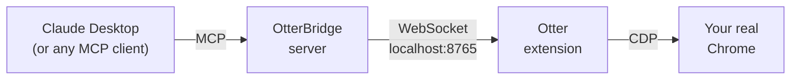

<div align="center">


# Otter & OtterBridge — Browser MCP

**Let your AI assistant drive your real Chrome — and ask you first before anything risky.**

[](https://github.com/wen-da-ng/otterbridge-browser-mcp/releases/latest)
[](LICENSE)
[](https://modelcontextprotocol.io)
[](extension/)
[](https://github.com/wen-da-ng/otterbridge-browser-mcp/releases/latest)

[Install](#install--claude-desktop) ·
[How it works](#how-it-works) ·
[Tools](#what-your-ai-can-do) ·
[Security](#safety--security) ·
[For developers](#for-developers)

</div>

> **For personal use only.** Not for publication or distribution. It operates
> your real, logged-in browser (see [Security](#safety--security)).

## How it works

Two pieces work together: the **Otter** Chrome extension (the hands & eyes) and
the **OtterBridge** MCP server (the connector). Any MCP client can drive it —
Claude Desktop, Claude Code, MCP Inspector, or your own agent.



Your AI assistant reads pages, clicks, fills forms, scrolls, waits for dynamic
content, takes screenshots — and debugs web apps via the captured console and
network traffic — with a visible animated cursor, an audit log, and a hard
rule: clicks on anything that looks destructive (*Buy, Pay, Send, Delete…*)
stop and ask **you** first.

## Install — Claude Desktop

All you need is **Google Chrome** and **Claude Desktop** — no Node.js, no git,
no terminal.

> **Supported clients:** Claude Desktop **chat sessions**, Claude Code, and any
> other MCP client. **Claude Desktop CoWork is not supported yet** — CoWork runs
> its agent in a sandboxed VM that currently fails to connect to locally
> installed MCP extensions
> ([known issue](https://github.com/anthropics/claude-code/issues/27492)).
> Use a regular chat session instead.

**1 — Download two files** from the
[latest release](https://github.com/wen-da-ng/otterbridge-browser-mcp/releases/latest):
`otterbridge-browser.mcpb` and `otterbridge-browser-extension.zip`.

**2 — Add the extension to Chrome:** unzip `otterbridge-browser-extension.zip` to a permanent
spot (e.g. `Documents\Otter` — Chrome keeps loading it from there, so don't
delete it later). Then open `chrome://extensions`, switch on **Developer mode**
(top-right), click **Load unpacked**, and pick the unzipped `extension` folder.

**3 — Add the bridge to Claude Desktop:** double-click `otterbridge-browser.mcpb` and
confirm the install. Two safety checkboxes appear — **keep the defaults**.

**4 — Try it:** with Chrome open, ask Claude:
*"Open example.com and tell me what's on the page."*

**Optional — extra security with pairing:** switch on **Require pairing** in
the Otter popup and ask Claude to *"pair my browser"*. Claude shows you a code
in a prompt: paste it into the popup, press **Pair**, then type the code's last
4 characters in the prompt and press **Accept**. Another Chrome profile? In a
paired profile's popup press **Show code → Copy** and paste it there. See
[Security](#safety--security) for what it protects against.

<details>
<summary><b>No release download available?</b></summary>

Use the direct copy of
[`otterbridge-browser.mcpb`](https://github.com/wen-da-ng/otterbridge-browser-mcp/raw/main/server/otterbridge-browser.mcpb),
and for the extension click the green **Code** button on the repo page →
**Download ZIP** (the extension is the `extension` folder inside).
</details>

<details>
<summary><b>Troubleshooting</b></summary>

- **Nothing happens?** Make sure Chrome is open and the Otter extension is
  loaded (`chrome://extensions`). The extension reconnects automatically.
- **A red "!" on the Otter icon / "not paired with this computer yet"?** That
  profile has *Require pairing* on and needs the code. Ask Claude to "pair my
  browser" — it shows you the code — or copy it from a paired profile's popup
  (**Show code**). Or switch *Require pairing* off.
- **"The pairing code … doesn't match"?** Paste the code again in the Otter
  popup. (The code only changes if OtterBridge's settings folder was deleted.)
- **"The Otter Chrome extension is older than this OtterBridge server"?**
  Download the matching `otterbridge-browser-extension.zip`, replace the
  unzipped folder, and click ↻ on the extension at `chrome://extensions`. The
  extension and the `.mcpb` should always come from the same release.
- **Not showing up in CoWork?** CoWork isn't supported yet (see the note
  above) — use a regular Claude Desktop chat session.
- A **"Chrome is being debugged" banner** appears at the top — normal and
  harmless; websites can't see it.
- `chrome://` pages, the Chrome Web Store, and PDFs can't be read or clicked —
  Chrome doesn't allow it.
- **"The page stopped responding — most likely a JavaScript dialog…"** — a page
  opened an `alert` / `confirm` / `prompt`, which freezes it. The AI answers it
  with `handle_dialog`; you'll be asked to approve an OK, because the dialog's
  text can't be read.
- **A "Connection refused" error for `ws://localhost:8765`** on the extension's
  error page just means no AI client was running at that moment. It's
  harmless and stops once one connects.
- **"Otter · …" windows** stay open for 5 minutes after a session ends, so you
  can see what it did, then close themselves (Options → *Close agent
  windows…* turns that off). The same Claude session reuses its window, even
  after `/mcp` reconnects or an extension reload.
- **"Otter · …" groups on the bookmarks bar?** Chrome shows every open tab
  group there and keeps it if its window closes with the group still in it.
  An agent's window is grouped only while the agent works (the group dissolves
  30 s after its last action), so closing an idle agent window yourself leaves
  nothing behind; OtterBridge also closes agent windows 5 minutes after their
  session ends, and **Close agent windows** in the popup does it at once.
  Delete older leftovers once by right-clicking them → **Delete group**.
</details>

## What your AI can do

Forty-four tools, each taking an optional `tab` id — plus multi-tab,
multi-agent control where every MCP session works in its own Chrome window and
colored tab group. Everything that reads or acts on a page also works **inside
iframes** (payment forms, embedded editors, nested frames) and **shadow DOM**
(web components). Actions **report what changed** — "navigated to …", "opened a
new tab", "a dialog opened", "download started", "no visible change" — so the
AI rarely needs a second call just to check.

<details>
<summary><b>Observe &amp; navigate (10)</b></summary>

| Tool | Does |
|---|---|
| `page_snapshot(scope?, max_lines?, tab?)` | **Usually the best first look.** Compact outline of the page: headings, sections, dialogs, short text, and every interactive element with its index, role, state (checked, disabled, value) and link target. Far cheaper than a screenshot; the indices work with `click_element` / `fill_element`. |
| `navigate(url, tab?)` | Point a tab at a URL, wait for load. |
| `go_back(tab?)` / `go_forward(tab?)` | Move through the tab's history. |
| `reload(hard?, tab?)` | Reload the tab; `hard` bypasses the cache. |
| `read_page(offset?, max_chars?, tab?)` | URL, title, visible text (iframes included, each under a marker) — paginated: result carries `total_chars`, pass `offset` for the next chunk. |
| `read_elements(scope?, query?, max?, tab?)` | Numbered interactive elements with center coordinates and state; filter to what's on screen or by text, capped at 300 by default. |
| `find_text(query, nth?, scroll?, tab?)` | Case-insensitive text search: match coordinates + context, auto-scrolls a match into view. |
| `wait_for(text?, selector?, url?, timeout_ms?, tab?)` | Wait for dynamic content — text, a CSS selector, and/or a network response whose URL contains `url` — instead of polling screenshots. |
| `screenshot(full_page?, index?, tab?)` | JPEG of the viewport, the whole page, or one element — via CDP (works on background tabs too). |
</details>

<details>
<summary><b>Act (11)</b></summary>

| Tool | Does |
|---|---|
| `click_element(index, button?, double?, tab?)` | **Preferred.** Clicks a `read_elements` entry by index; coordinate resolved in-page, so it never drifts through screenshot scaling. `button: "right"` right-clicks (context menus), `double: true` double-clicks. Never clicks through an overlay — it says what's in the way. |
| `click(x, y, button?, double?, tab?)` | Animated-cursor move + trusted CDP click at raw coordinates. Destructive targets prompt for approval (left clicks — a right-click only opens a menu). |
| `fill_element(index, text, tab?)` | Focus + select-all + type over, atomically — the reliable way to fill form fields. Empty text clears. |
| `select_option(index, value?/label?, tab?)` | Pick an option in a native `<select>` (dropdowns can't be clicked). |
| `hover(index?/x,y?, tab?)` | Animated hover — opens hover menus, tooltips, `:hover` states. |
| `drag(from_x, from_y, to_x, to_y, tab?)` | Press–glide–release — sliders, sortable lists, canvas tools. |
| `type_text(text, tab?)` | Per-character typing with human-like jitter, into the focused element. |
| `press_key(key, tab?)` | A key or shortcut: `Enter`, `Tab`, `Escape`, `F5`, or combinations like `Control+A`, `Shift+Tab`, `Control+Shift+P`. |
| `scroll(delta_y, index?, x?, y?, tab?)` | Vertical scroll with jittered delta — over an element or point to scroll an inner panel. |
| `handle_dialog(accept, text?, tab?)` | Answer a JavaScript `alert` / `confirm` / `prompt` / "Leave site?" dialog. OK on a destructive-looking confirm needs your approval. |
| `upload_file(files, index?, selector?, tab?)` | Attach local files to an upload control — no file dialog. **Always asks your approval** (it sends your files to the site). |
</details>

<details>
<summary><b>Files, debugging &amp; testing (7)</b></summary>

| Tool | Does |
|---|---|
| `read_console(level?, limit?, clear?, tab?)` | Captured `console.*` output, uncaught exceptions, and browser log (500-entry ring buffer per tab). |
| `read_network(filter?, limit?, clear?, tab?)` | Captured requests: URL, method, status, type, size (300-entry ring buffer). |
| `get_network_body(request_id, tab?)` | Response body of a captured request (truncated at 50k chars). |
| `evaluate_js(code, tab?)` | Run JavaScript in the page. **Off by default** — enable in the extension options, and every call still asks for your approval. |
| `wait_for_download(timeout_ms?)` | Wait for a download to finish; returns the saved file's full path, size and type. |
| `save_pdf(path?, tab?)` | Save the page as a PDF (default: your Downloads folder, named after the page). |
| `set_viewport(width?, height?, mobile?, scale?, reset?, tab?)` | Emulate another screen size, e.g. a phone, to test responsive layouts. |
</details>

<details>
<summary><b>Measure &amp; optimise your web app (4)</b></summary>

| Tool | Does |
|---|---|
| `perf_audit(url?, cold?, network?, cpu?, settle_ms?, tab?)` | Reloads the page (cold cache by default) and reports load metrics — TTFB, FCP, LCP and its element, CLS, Total Blocking Time — plus main-thread and memory figures, network totals by type, third-party hosts, the largest / slowest / failed requests, the longest frames with the script and function behind them, console errors, and **prioritised findings** (uncompressed text, huge images, render-blocking CSS, missing caching, …). `network` / `cpu` throttle that run only. |
| `perf_record(action, tab?)` | `start`, do something (click, type, scroll), `stop`: the slowest interactions, long frames, layout shifts, main-thread time, and the change in JS heap and DOM size. Repeat an action several times to spot a leak. |
| `throttle(network?, cpu?, reset?, tab?)` | Simulate slow-3g / fast-3g / fast-4g / offline and a slower CPU — stays on until `reset`. |
| `css_coverage(action, tab?)` | `start`, reload and/or use the page, `stop`: unused bytes per stylesheet. |

Numbers are lab data from one run on your machine: compare **before and
after** a change rather than against a target. A browser extension can't use
Chrome's JavaScript profiler, so there's no JS coverage or CPU profile — the
long-frame report names the script and function behind each slow frame
instead. In Claude Code, the AI can measure, find the cause in your source,
fix it, and measure again.
</details>

<details>
<summary><b>Replay a recorded flow (1): <code>run_script</code></b></summary>

`run_script(steps, vars?, fast?, background?, tab?)` replays a whole flow the AI
has already done once — **in one call, at full speed**, with no model
round-trip between steps. Typical use: do a task interactively once, save the
steps (in a file or a skill), then replay them whenever the task recurs.

- **Steps:** `navigate`, `click`, `fill`, `select`, `type_text`, `press_key`,
  `scroll`, `wait_for`, `drag`, `dialog`. A click can be `button: "right"` or
  `double: true`; `wait_for` can wait on text, a CSS selector, or a network
  response (`url`); `dialog` answers an alert / confirm / prompt.
- **Durable targets:** elements are found by `{"selector": …}` and/or
  `{"text": …, "tag": …, "nth": …}` (exact → prefix → substring match), never by
  `read_elements` indices, so a script recorded today replays tomorrow. Each
  target is waited for (default 8 s) instead of failing on a slow page.
- **Variables:** any `{{placeholder}}` in a step is filled from `vars` — one
  recorded flow, fresh inputs every run. Missing values fail before anything
  runs.
- **Failure:** the script stops at the first failed step (unless the step is
  `"optional": true`) and reports per-step results, so the AI can take over
  interactively from where it stopped.
- **`fast`** (default on) skips the cursor animation and typing delays;
  **`background: true`** never brings the tab to the front, so you can keep
  working elsewhere.
- The approval gate applies to every scripted click and dialog exactly as in
  interactive use.

```json
{
  "steps": [
    { "action": "navigate", "url": "https://example.com/login" },
    { "action": "wait_for", "selector": "input[name=email]" },
    { "action": "fill", "target": { "selector": "input[name=email]" }, "text": "{{email}}" },
    { "action": "click", "target": { "text": "Continue", "tag": "button" } },
    { "action": "wait_for", "text": "Dashboard" }
  ],
  "vars": { "email": "someone@example.com" }
}
```

A real recorded example lives in
[`examples/shan-farm-order.replay.json`](examples/shan-farm-order.replay.json).
</details>

<details>
<summary><b>Record &amp; replay flows (3): <code>record_flow</code>, <code>flows</code>, <code>run_flow</code></b></summary>

Do a task **yourself, once**, and let the AI repeat it with new values.

1. **Record.** In the Otter popup press **Record this tab** — the toolbar icon
   shows a red **REC** — and do the task in that tab: fill the form, pick
   options, click through. Reopen the popup to see `Recording · N steps`, then
   **Stop**, name the flow and **Save** (or **Discard**). The AI can start the
   same thing with `record_flow(action="start")` — you're asked to approve it
   first — and save it with `record_flow(action="stop", name=…)`.
2. **Replay.** Ask Claude to run it by name: `run_flow(name, vars?)` replays it
   in the AI's own window (never your tab), in one call, through the same
   engine as `run_script`. Every value you typed became a variable — the
   recorded value is its default, and `vars` replaces it:
   `run_flow("Order lunch", {"email": "someone@example.com"})`. Destructive
   clicks (Submit, Pay, Send, …) still ask you, exactly as when the AI clicks
   them itself.
3. **Manage.** Saved flows are listed in the popup (✕ deletes one). The AI uses
   `flows(action="list" | "get" | "save" | "delete")` — e.g. to fix a step
   that stopped matching the page and save the flow back. Replacing or deleting
   a flow asks you first.

**Passwords and codes are never recorded.** Password fields, one-time codes
and card fields (by type, `autocomplete`, or a name like *password*, *otp*,
*cvv*) are kept as a "sensitive" step with no value — the value never leaves
the page. On replay, if Chrome's password manager has filled the field the
flow carries on; otherwise it stops there and asks you to type it in the Otter
window, then resumes with `run_flow(…, from_step=N)`.

Flows are stored in the browser profile they were recorded in (up to 200
flows × 300 steps), survive server restarts, and keep the values you typed
(other than passwords) as their defaults.

**Not recorded:** scrolling (replay scrolls to each target by itself),
hovering, drag and drop, file uploads, and JavaScript dialogs. Elements are
remembered by a stable attribute (`data-testid`, a stable `id`, `name`,
`aria-label`), their visible text, or as a last resort their position in the
page. A target that isn't unique inside an **iframe** is remembered by its
position among matches in that frame, but replay counts matches across all
frames — so it can pick the wrong frame's element; unique targets (the usual
case) aren't affected.
</details>

<details>
<summary><b>Multi-tab / multi-agent</b></summary>

Each MCP **session** is an agent with its **own Chrome window**, labelled with a
colored **tab group** (e.g. `Otter · Claude Code 2`) while the agent works. The window is
opened (unfocused, so it never grabs your keyboard) on the session's first tool
call — agents never act in the tabs you're using. Tabs a page opens inside an
agent window are pulled into its group automatically, popups an agent's page
opens (e.g. "Sign in with Google") belong to that agent too, and grouping is
verified: if Chrome dropped the group (its last tab closed), it's recreated.
A client that reconnects (`/mcp`) — or an extension reload — finds the same
window again and carries on in its current tab.

**Cleaning up:** Chrome saves every tab group to the bookmarks bar and keeps
it if its window closes with the group still in it. So the group is only there
while the agent works — it dissolves 30 s after the agent's last action — and
closing an idle agent window yourself leaves nothing behind. Agent windows also
close themselves 5 minutes after their session ends (Options → *Close agent
windows…*), and **Close agent windows** in the popup closes them all at once.

**Several Chrome profiles** (e.g. work and personal Google accounts): install
the extension in each profile you want the AI to reach. Each profile tells the
AI its name and signed-in account — rename it in the extension popup ("This
profile"), e.g. *Work*. `list_profiles()` shows what's connected and
`use_profile(profile)` sets the session's default by name or email, and
`open_tab(url, profile)` opens a tab in a specific profile (`pair_browser()`
shows you the pairing code when a profile with pairing on is waiting). Every tab stays
tied to the profile it was opened in — any call that passes its `tab` acts
there — so one session (e.g. parallel subagents) can work in several profiles
at once, and different sessions can drive different profiles at the same
time. Results name the profile. With only one profile connected nothing changes. With
several, the AI must choose (it refuses to guess, so nothing happens in the
wrong account) — or pin a client to one profile with `OTTERBRIDGE_PROFILE`
in its MCP config (e.g. `"env": { "OTTERBRIDGE_PROFILE": "Personal" }`). A
profile's extension only runs while that profile has a window open.

It's all live — nothing needs reconnecting: open another profile (or install
the extension in one) and it joins within seconds; close one and it drops
out. The AI is told either way in its next tool result ("→ Browser profile
connected: Personal …"). Group numbers are handed out per *session*, so a
session is "Otter · Claude Code 2" in every profile it uses, and no two
sessions share a number.

**Subagents** of one Claude session share that session's window. To work in
parallel, each opens its own tab (`open_tab`) and passes that `tab` id on every
call — the server's instructions tell the model so. Actions on one tab run one
at a time, so parallel calls can never interleave keystrokes.

Manage tabs with `open_tab(url?)`, `list_tabs()`, `use_tab(tab)`,
`close_tab(tab)`. Your own tabs are **read-only** to agents:
`get_user_tab()` returns the tab you're looking at, which works with
`read_page`, `read_elements`, `find_text`, `wait_for` and `screenshot` — any
action on it is refused.

**Several clients at once** (Claude Code *and* Claude Desktop, or a background
session in another project): the first server owns `8765` and acts as a small
registry; every other server takes its own port in `8766–8774` and registers
there, and the extension connects to each one it's told about — so every client
works simultaneously, and the extension never dials empty ports. If the
registry's client exits, another server takes `8765` over.
</details>

<details>
<summary><b>Cursor &amp; input settings</b></summary>

The extension has a settings UI — the toolbar **popup** (preset switch, cursor
toggle, **Fast mode** and **Full Auto**) and a full **options page** (right-click
the icon → Options). **Fast mode** drops the cursor glide and typing delays —
still real, trusted input events, just without the waiting (script replays are
always fast).
Tune move speed, curvature, easing, typing speed, scroll, idle drift, cursor
size/colors/glow, and visibility — with **presets** (Natural / Fast / Instant)
and a live preview. Settings sync via `chrome.storage.sync` and apply live.
</details>

## Safety & security

Every action is **audit-logged**, destructive clicks require **your approval**,
sites you choose can be **blocked, read-only or always-ask**, and everything
binds to **localhost only** — nothing is exposed to the network.

<details>
<summary><b>Site rules: block, read-only, always ask</b></summary>

Decide per website what AI agents may do there. In the Otter popup, the row
under the header shows the site of the tab you're on with
**Normal · Ask · Read · Block**; the full list is in Options → *Site rules*.

| Mode | AI agents may | Good for |
|---|---|---|
| **Block** | nothing — not open, read, screenshot or act | online banking, password managers |
| **Read** | read and look (page text, elements, screenshots, console / network, measurements), not click, type or navigate | admin consoles you want summarised, not touched |
| **Ask** | read freely; **every action** needs your OK — one OK covers that site in that tab for 5 minutes | sites where any slip matters |
| *(no rule)* | as usual | |

- **Ask works with Full Auto on.** Full Auto skips the destructive-action
  prompts, but an Ask site still asks before every action (and
  `BROWSER_AGENT_GATE=off` doesn't switch it off either). That's what makes
  Full Auto safe to leave on: put the sites that matter on Ask or Block. An AI
  app that can't show prompts is simply refused on Ask sites. A click you
  approved as destructive ("Delete …") counts as your OK for that click.
- A rule covers the site and all its subdomains (`bank.com` covers
  `www.bank.com` and `login.bank.com`). When several match, the most specific
  wins, so you can carve out exceptions: `bank.com` on Block with
  `news.bank.com` on Read.
- The extension enforces the rules, where the tab's real address is known:
  opening a blocked site is refused before it loads, and an agent's tab that is
  redirected into one is sent back to a blank page. A link an agent's page
  follows by itself can still *load* a blocked site, but nothing can be read
  or done there.
- **Only you can change rules** — in the popup or Options. No AI tool can, just
  like Full Auto. They sync with your other Otter settings.
</details>

<details>
<summary><b>Full security model</b></summary>

- **Audit log:** every dispatched action is appended to `server/agent_actions.log`.
  What gets typed (`fill_element`, `type_text`, prompt answers) and JavaScript
  run via `evaluate_js` are logged only as their length, never their content;
  a saved flow is logged by name and step count, never its recorded values.
- **Passwords stay hidden:** password fields never report their value — not in
  `read_elements`, `page_snapshot` or the approval gate — and the flow
  recorder never records them (nor one-time codes or card numbers).
- **Recording needs you:** a flow is recorded only in your own tab, started by
  you in the popup or by the AI after you approve it, with a red **REC** on the
  toolbar icon the whole time.
- **Dialogs and uploads are gated too:** OK on a `confirm()` that reads
  destructive ("Delete 3 files?") needs approval like a destructive click, and
  every `upload_file` asks first, since it sends your files to the website.
- **Full Auto:** the **Full Auto** switch in the extension popup (also in
  Options → Advanced) skips every approval prompt below, for all connected
  clients, immediately — for unattended runs such as Claude's auto mode. The
  toolbar icon shows a small orange fast-forward mark (▶▶) while it's on
  (hover the icon for "Full Auto is ON"). It is deliberately a
  browser-side switch: no MCP tool can change it, so a prompt-injected agent
  can't turn its own approvals off. Auto-approvals are still audit-logged.
  Sites you set to **Ask** keep asking with Full Auto on (see *Site rules*).
- **Site rules:** block a site, make it read-only, or make every action there
  ask first — set by you only, enforced by the extension, and logged
  (`site` entries: allowed / denied / blocked). See *Site rules* above.
- **Destructive-action gate:** a `click` (or an Enter that would trigger one —
  see below) whose target text matches danger words
  (`buy/pay/delete/send/submit/checkout/confirm/transfer/…`) is hit-tested at
  dispatch and requires human approval via MCP elicitation. Works for every
  click — vision-mode, `read_elements`, raw coordinates, scripted, or inside an
  iframe (the element *in* the frame is checked, not the frame). The target is
  re-checked right before the press, and a click is never pressed through an
  overlay (cookie banner, modal) — it's aborted, naming what's in the way.
  Right-clicks aren't gated: they only open a menu, and picking "Delete" from
  that menu is a gated left click.
  - `BROWSER_AGENT_GATE=elicit` (default) | `off` (also accepts `true`/`false`)
  - `BROWSER_AGENT_GATE_FALLBACK=deny` (default) | `allow` — used only if a
    client can't show an elicitation prompt. (The `.mcpb` exposes both as
    checkboxes in Claude Desktop's settings.)
- **`evaluate_js` is doubly gated:** disabled unless you switch it on in the
  extension's options page (Advanced), and even then every call goes through
  the same human-approval elicitation as destructive clicks.
- **Pairing (opt-in):** without it, the extension trusts whatever answers on
  `localhost:8765–8774` — another program on your computer that grabs those
  ports gets your profile name and Google email and can drive your browser
  without approval prompts. Switch on *Require pairing* in the popup and the
  extension and every OtterBridge server must prove they share a pairing code
  (in `~/.otterbridge/pairing.json`), in both directions, before anything else
  is exchanged; the HTTP endpoint then needs it as a bearer token. This keeps
  out other users of the computer, containers / VMs / WSL sharing
  `localhost`, sandboxed apps, and any unrelated program listening on those
  ports. It does **not** protect against a program running as *you* with
  access to your files: that program can read the code, like any other file of
  yours. The code is shown to you, never to the AI, and never written to the
  audit log. The setting is per computer and only changes through a paired
  extension or your OK in the AI app, so a fake extension can't switch it off.
- **Second line of defence:** commands you approved are marked as approved,
  and the extension itself refuses a destructive-looking click, an OK on a
  destructive dialog, an upload or `evaluate_js` that arrives unmarked (unless
  Full Auto is on). Approval prompts still appear in your AI app, as before.
- **Enter is gated too:** pressing Enter (or typing a line break) submits a
  form just like its submit button, and chat boxes send on Enter. Before it,
  OtterBridge checks what Enter would trigger — the form's submit button, the
  focused button, or the buttons around a chat box — and asks you first when
  that looks destructive ("Send", "Pay", "Submit order"…). Shift+Enter, the
  newline key in chat boxes, isn't gated.
- Servers bind to **localhost only**. Never expose them on the network.
- **Bridge & endpoint are origin/host-locked** (defense against local-page
  attacks): the `ws://localhost:8765–8774` bridge only accepts the extension
  (`chrome-extension://` origin) or non-browser clients — a web page you visit
  can't connect to eavesdrop on or displace it. The 8765 registry only ever
  points the extension at ports inside that range. The HTTP endpoint rejects
  requests whose `Host`/`Origin` isn't loopback, blocking DNS-rebinding attempts
  to drive the browser from a malicious site.
- **Supply chain:** install with `npm ci --ignore-scripts`; no production
  dependency runs install scripts, and the committed `package-lock.json` pins
  versions. The shipped `.mcpb` is a single bundled file (no loose deps).
- Runs in your **real Chrome profile** (real logins). For isolation, load the
  extension in a dedicated Chrome profile instead.
- Main residual threat is **prompt injection** from page content; keep the gate on.
</details>

## For developers

Everything below needs **git** and **Node.js ≥ 18** — regular Claude Desktop
users never touch this. Any number of servers can run at once (Claude Code,
the `.mcpb` inside Claude Desktop, ...): the first owns `ws://localhost:8765`
(the registry), the rest take their own port in `8766–8774` and register there,
and the extension connects to each.

<details>
<summary><b>Components</b></summary>

| Path | What it is |
|---|---|
| `extension/` | Chrome MV3 extension — the hands & eyes. WebSocket client + `chrome.debugger` (CDP) input + animated fake cursor + a settings UI (popup + options page). |
| `server/` | **OtterBridge (Node/TypeScript)** — the MCP server. Bridges browser actions to the extension over `ws://localhost:8765–8774`, with two transports from one codebase: **stdio** (for the `.mcpb` / Claude Desktop) and **streamable HTTP** at `http://localhost:8000/mcp` (for Claude Code, MCP Inspector). Bundles into a one-click `.mcpb`. |
| `legacy/` | The original **Python** (FastMCP) server + its setup scripts, kept as a reference/fallback. Single-tab only. See [`legacy/README.md`](legacy/README.md). |
</details>

<details>
<summary><b>Claude Code</b></summary>

Build once (both options need `dist/index.js`), and load the extension from
your clone's `extension/` folder:

```bash
git clone https://github.com/wen-da-ng/otterbridge-browser-mcp.git
cd otterbridge-browser-mcp/server
npm ci --ignore-scripts   # reproducible install, no dependency install scripts
npm run build
```

**Option A — stdio (recommended, start-free).** Claude Code launches the server
itself on connect — just like the `.mcpb` in Claude Desktop — so there's no
`npm start` to remember. Register it once with the **absolute** path to your
built `dist/index.js`:

```
claude mcp add otterbridge-browser-mcp -- node /absolute/path/to/otterbridge-browser-mcp/server/dist/index.js --stdio
```

One session per Claude Code instance; it runs alongside the Claude Desktop
`.mcpb` and other Claude Code sessions (each takes its own bridge port). A
`/mcp` reconnect continues in the same Chrome window and tab.

**Option B — streamable HTTP (multi-agent).** Run one long-lived server that
many sessions share, each getting its own window and colored tab group. You start it
manually and keep it running:

```bash
npm start                 # streamable HTTP at http://localhost:8000/mcp
```

Then register it once, with the pairing code as a bearer token (a reconnect
fails with `-32000` if the server isn't running). `node dist/index.js
--pairing-code` prints the code:

```
claude mcp add --transport http otterbridge-browser-mcp http://localhost:8000/mcp --header "Authorization: Bearer <pairing code>"
```

The code lives in `~/.otterbridge/pairing.json` on macOS and Linux and in
`%USERPROFILE%\.otterbridge\pairing.json` on Windows (`OTTERBRIDGE_HOME`
moves it). Deleting it creates a new code on the next start, and every
extension then has to pair again.

Either way, wait for `[bridge] extension connected` (the extension
auto-reconnects), then run `/mcp` in Claude Code to attach.
</details>

<details>
<summary><b>MCP Inspector / any other MCP client</b></summary>

Start the server (`cd server && npm start`), then point the client at the
streamable-HTTP endpoint:
```
npx @modelcontextprotocol/inspector
```
Transport `Streamable HTTP` → `http://localhost:8000/mcp`, with the header
`Authorization: Bearer <pairing code>` (`node dist/index.js --pairing-code`
prints it).
</details>

<details>
<summary><b>Build the <code>.mcpb</code> from source / releases</b></summary>

```bash
cd server
npm ci --ignore-scripts
npm run pack              # esbuild bundle + LICENSE + mcpb pack → otterbridge-browser.mcpb
```

Releases are automated: pushing a `v*` tag makes CI run the test suite, pack
`otterbridge-browser.mcpb`, zip the extension, and attach both to a GitHub release.
</details>

<details>
<summary><b>Legacy Python server</b></summary>

The original Python implementation lives in [`legacy/`](legacy/) with its own
setup scripts (`bootstrap` + `start`) and docs. It's single-tab only. See
[`legacy/README.md`](legacy/README.md).
</details>

<details>
<summary><b>Reloading after code changes</b></summary>

| Changed | Do |
|---|---|
| `extension/*.js` | Reload the extension at `chrome://extensions` (↻), then refresh open tabs. |
| `server/src/*.ts` (Claude Code / Inspector) | `npm run build` in `server/`; restart the server; in Claude Code run `/mcp` to reconnect. |
| `server/src/*.ts` (Claude Desktop `.mcpb`) | Re-pack (`npm run pack` in `server/`) and reinstall the bundle. |
| `legacy/server-python/server.py` | See [`legacy/README.md`](legacy/README.md). |
</details>

<details>
<summary><b>Notes &amp; gotchas</b></summary>

- `chrome://` pages, the Web Store, and PDFs can't be read or clicked (they
  reject script injection).
- The **"Chrome is being debugged" banner** is cosmetic and unavoidable with
  `chrome.debugger`; websites cannot see it.
- Detection avoidance comes from running in your real browser, not the cursor
  animation.
- Some sites (e.g. Shopee) gate automated browsing of logged-out sessions behind
  an anti-bot / login wall; log in first for deep browsing.
- **JavaScript dialogs:** Chrome doesn't report them to extensions, so they're
  detected by the page freezing (within ~2 s) and their text can't be read.
- **Uploads into cross-origin iframes** (a file input inside an embedded
  third-party frame) aren't supported; uploads anywhere else are.
- **Native HTML5 drag-and-drop** (`draggable="true"`) may ignore synthetic
  mouse drags; sliders, sortable lists and canvas tools work.
- **Pages that block extension scripts entirely** (`data:` URLs, `chrome://`,
  the Web Store, PDFs) can be navigated and screenshotted, but not read or
  clicked.
</details>

## Roadmap

- [x] `.mcpb` Desktop Extension — one-click install in Claude Desktop, zero prerequisites
- [x] Multi-tab / multi-agent — per-session windows + tab groups, parallel control
- [x] Several AI clients at once (Claude Code + Claude Desktop + background sessions)
- [x] Script replay (`run_script`) — recorded flows in one call
- [x] Flow recorder — record a task in your own tab, replay it by name (`record_flow`, `flows`, `run_flow`)
- [x] Per-site rules — block, read-only or always-ask sites, set only by you
- [x] Iframes, shadow DOM, JS dialogs, file upload/download, key combinations
- [x] Page snapshot + "what changed" reports — fewer screenshots and round trips
- [x] Rookie-friendly releases — prebuilt `.mcpb` + extension zip on every release
- [x] Optional pairing + extension-side check of approvals
- [x] Web-app performance tools — page-load audit, interaction recording, throttling, CSS coverage
- [ ] Chrome Web Store (unlisted) — extension installs from a link, no Developer mode
- [ ] Detection refinements — brief-attach debugger, extra behavioral jitter, cursor overshoot
- [ ] Standalone example agent client (LangGraph/Ollama) — any MCP client can already attach

---

<div align="center">

_Built by <b>wen-da-ng</b> · OtterBridge_

</div>
